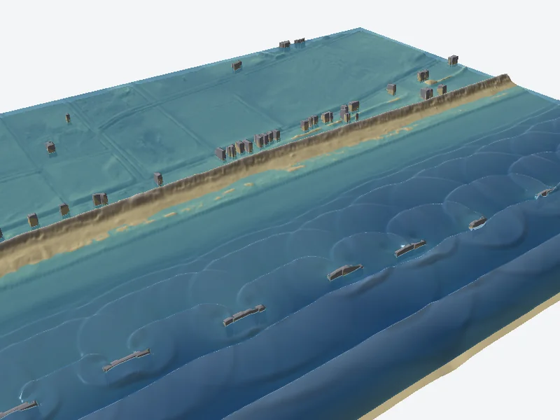
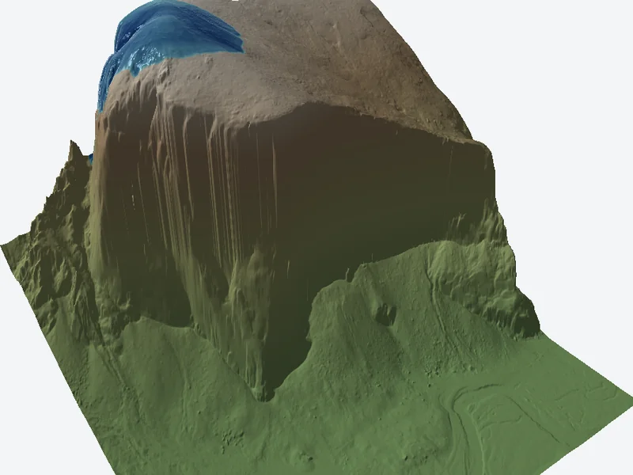
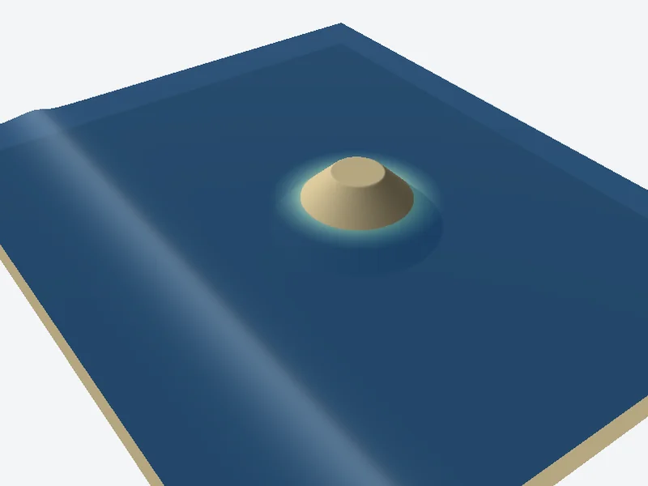
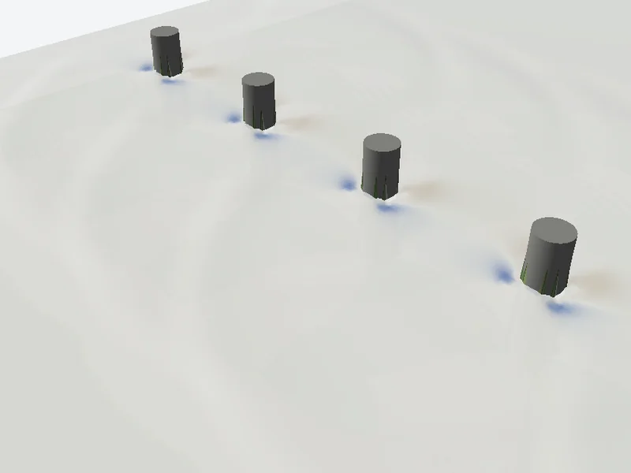
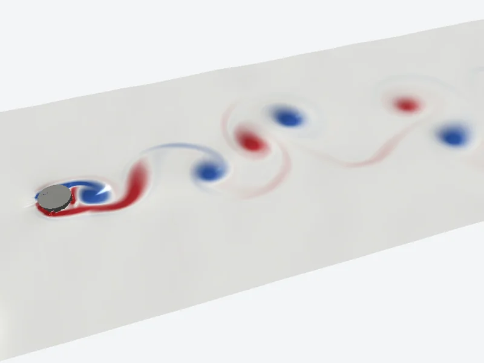
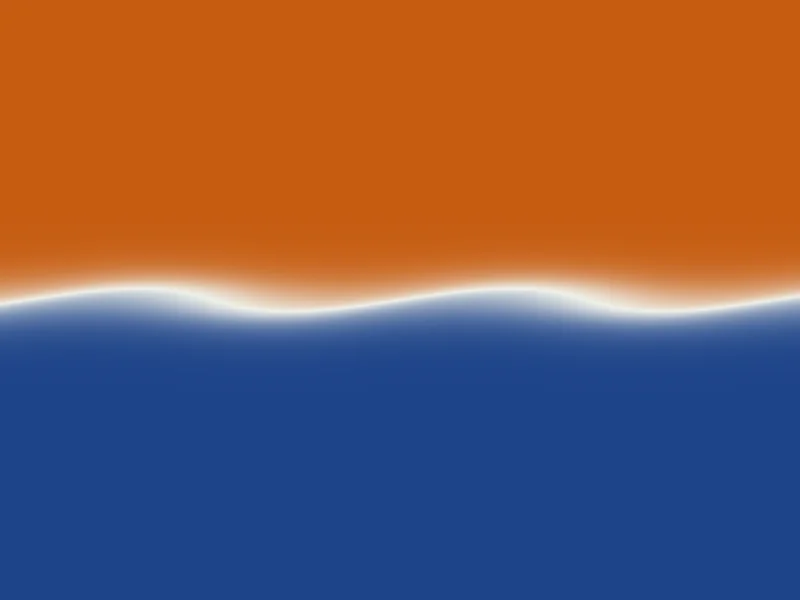
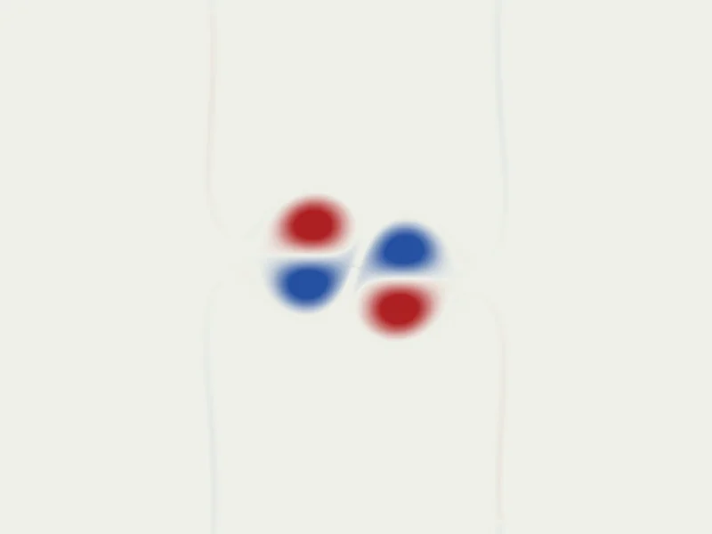

# FluxCell

A conservative, well-balanced, second-order finite-volume solver for the two-dimensional
shallow-water equations, written as WebGPU compute shaders. MUSCL-Hancock reconstruction, HLLC
fluxes and hydrostatic reconstruction run entirely on the GPU, in the browser, with double-precision
CPU references for testing. No dependencies and no build step.

- **Flow:** wetting and drying, variable bed, Manning friction, rain and point sources, solid cells
  (buildings, piers), wall, periodic, open and outflow boundaries, and stage, discharge and
  incident-wave hydrograph boundaries, with closed water budgets.
- **Physics options:** wind stress, Coriolis, a transported scalar with diffusion and settling
  (including flocculation), a depth-averaged turbulence closure, and a low-Froude correction.
- **Exactness:** lakes at rest stay exactly at rest in single precision; results do not depend on
  elevation offsets, batch size or kernel variant.
- **Performance:** a fused, tiled kernel chooses its own timestep on the GPU and reads back once
  per batch of up to 256 steps; a failed step is rolled back and retried.

<table>
  <tr>
    <td width="50%" valign="top"><br>
      <sub>Grand Isle, LA: 5 m waves on the Hurricane Ida still-water level overtop the dune (NOAA CUDEM, 2 m grid).</sub></td>
    <td width="50%" valign="top"><br>
      <sub>Yosemite: a 5 m column of water released above El Capitan runs down the face (2 m lidar).</sub></td>
  </tr>
  <tr>
    <td width="50%" valign="top"><br>
      <sub>A solitary wave wraps around a conical island (NTHMP benchmark 6).</sub></td>
    <td width="50%" valign="top"><br>
      <sub>Scour (blue) and deposition (brown) around four bridge piles.</sub></td>
  </tr>
  <tr>
    <td width="50%" valign="top"><br>
      <sub>A von Kármán vortex street behind an island, coloured by vorticity.</sub></td>
    <td width="50%" valign="top"><br>
      <sub>A shear layer rolls up into Kelvin–Helmholtz billows.</sub></td>
  </tr>
  <tr>
    <td width="50%" valign="top"><br>
      <sub>Waves diffract through two slits and interfere.</sub></td>
    <td width="50%" valign="top"><br>
      <sub>Two Lamb–Chaplygin dipoles collide and exchange partners.</sub></td>
  </tr>
</table>

**Demos and documentation:** interactive 2D and 3D demos, usage, equations and verification at
[hydroinformatics.tulane.edu/lab/fluxcell](https://hydroinformatics.tulane.edu/lab/fluxcell/).

## Installation

The library is plain ES modules with no dependencies and no build step. Install it from GitHub,

```sh
npm install github:uihilab/FluxCell
```

or copy `src/` into a project. The shaders are loaded relative to the module URL, so
`src/shaders/` must stay next to `src/webgpu.mjs` and be served with the modules.

## Usage in the browser

```js
import { compileKernels, createSolver } from 'fluxcell'; // or './src/index.mjs'

const device = await (await navigator.gpu.requestAdapter()).requestDevice();
const kernels = await compileKernels(device, 'muscl-fused');

const width = 200, height = 100, n = width * height;
const bed = new Float32Array(n);                 // bed elevation (m)
const state = new Float32Array(4 * n);           // [h, hu, hv, 0] per cell
for (let i = 0; i < n; i++) state[4 * i] = i % width < 50 ? 2 : 0.5;

const solver = await createSolver(device,
    { width, height, dx: 1, dy: 1, boundaryX: 'outflow', boundaryY: 'wall' },
    { state, bed, manning: new Float32Array(n).fill(0.03) }, kernels);
await solver.advance(30);                        // 30 s, timestep chosen on the GPU
const result = await solver.readState();         // [h, hu, hv, c] per cell
solver.destroy();
```

WebGPU needs a secure context (HTTPS or localhost). Grids are row-major with row 0 at the south
edge. `compileKernels` takes one of three schemes: `muscl-fused` (the production path, one tiled
dispatch per step), `muscl-hancock` (the same discretization in separate passes), and `rusanov`
(first order, the control).

### Inputs

- **Options:** grid size and cell sizes, `boundaryX` and `boundaryY` (`wall`, `periodic`, `open`
  or `outflow`), `hydrographs` (stage, discharge or incident-wave series on edge segments), uniform
  `rain`, `cfl`, and the physics options (`wind`, `coriolis`, `tracer`, `diffusivity`, `settling`,
  the turbulence closure, and `lowFroude`).
- **Initial data:** `state` and `bed`, with optional per-cell `manning`, `source` (m/s), `solid`
  cells (buildings, piers), and tracer `concentration`.

Every option, with its units, default, and limits, is listed in [docs/API.md](docs/API.md); the
types are in `src/index.d.ts`.

### Render loops

`encode(encoder, { duration })` records a batch of steps into your own command encoder and returns
the state buffer they write, so later passes (a renderer, a particle tracer) can read it in the same
submission. After submitting, `await solver.resolve()` accepts the steps, or rolls the batch back
and redoes it with smaller steps if a step failed.

```js
const encoder = device.createCommandEncoder();
const stateBuffer = solver.encode(encoder, { duration: frameSeconds });
drawWater(encoder, stateBuffer);                 // your render pass
device.queue.submit([encoder.finish()]);
await solver.resolve();
```

### Changing a run

Between steps, `setForcing` replaces Manning n, sources, and source concentrations;
`setParameters` changes wind, Coriolis, and settling; `setHydrographs` replaces boundary series;
and `setBed` edits the bed of given cells. Invalid changes throw and leave the state untouched.

## Usage in Node

The f64 CPU references, `ReferenceSolver` (first order) and `MusclReferenceSolver` (second order),
take the same options and initial data and run in Node 20 or later:

```js
import { MusclReferenceSolver, diagnostics } from 'fluxcell';

const width = 100, height = 50, n = width * height;
const state = new Float64Array(4 * n);                       // [h, hu, hv, 0] per cell
for (let i = 0; i < n; i++) state[4 * i] = i % width < 25 ? 2 : 0.5;

const solver = new MusclReferenceSolver(
    { width, height, dx: 1, dy: 1, boundaryX: 'outflow', boundaryY: 'wall' },
    { state, bed: new Float64Array(n), manning: new Float64Array(n).fill(0.03) });
while (solver.time < 10) solver.step(10 - solver.time);     // each step capped at the time left
console.log(diagnostics(solver.readState(), solver.config)); // volume, depth and speed extremes
```

They suit tests, small grids, and checking GPU results. The GPU solvers need a `GPUDevice`; Node
has no WebGPU of its own, so a binding that provides one is required, after which the code is the
same as in the browser (the shaders are then read from disk).

## Testing

```sh
npm test        # CPU reference suite (Node 20 or later)
npm run serve   # http://localhost:8080/ for the GPU suites below
```

GPU suites run in the browser; each page reports pass or fail and a JSON summary.

| Page | Checks |
|---|---|
| `tools/validate/` | Equilibria, budgets, agreement with the f64 references, convergence, dam breaks, kernel equivalence, batch invariance, run-time changes |
| `tools/transport/` | Scalar transport, settling and turbulence closure: f64 equivalence, exact solutions, rollback, stress |
| `tools/swashes/` | SWASHES analytic solutions (Thacker paraboloid, Goutal–Maurel bump flows) |
| `tools/ea/` | UK Environment Agency 2D benchmarks 1 to 6B (data downloaded separately; see `tools/ea/README.md`) |
| `tools/nthmp/` | NTHMP laboratory benchmarks 6 (conical island) and 7 (Monai Valley) |
| `tools/stress/` | Seeded fuzzing: 500 random cases with thin films, cliffs, buildings and hydrographs |
| `tools/precision/` | Elevation offsets from 0 to 8,000 m with and without the datum shift |
| `tools/dynamics/` | Kelvin–Helmholtz growth, vortex shedding, vortices leaving through boundaries, decaying turbulence |
| `tools/terrain/`, `tools/lidar/` | Runs on real 10 m and 2 m terrain |
| `tools/benchmark/`, `tools/perf/` | Throughput, GPU kernel time, batch size, cost at matched accuracy |

Some suites need data that is not in the repository. The NTHMP pages read the laboratory records
from `data/nthmp/`:

```sh
git clone --depth 1 https://github.com/rjleveque/nthmp-benchmark-problems data/nthmp-src
mkdir -p data/nthmp
cp -r data/nthmp-src/BP06-FrankG-Solitary_wave_on_a_conical_island data/nthmp/BP06
cp -r data/nthmp-src/BP07-DmitryN-Monai_valley_beach data/nthmp/BP07
```

`tools/lidar/` runs on the full 2 m tiles; without them it falls back to the smaller demo windows
in `data/dem/`. The full tiles are fetched from USGS 3DEP:

```sh
node tools/dem/fetch-3dep.mjs yosemite-elcapitan-2m -119.633 37.724 1536 2 "CA_YosemiteNP_2019|CA_SouthernSierra_2020"
node tools/dem/fetch-3dep.mjs neworleans-17thstreet-2m -90.115 30.006 2048 2 LA_2021GreaterNewOrleans
```

The UK Environment Agency data are described in `tools/ea/README.md`. The Python scripts in
`tools/dem/` and `tools/nthmp/analysis.py` need the packages in `tools/requirements.txt`
(`pip install -r tools/requirements.txt`). Pages that save fields write them to `data/figures/`,
which is not versioned.

## Repository layout

| Path | Contents |
|---|---|
| `src/` | The library: GPU solvers (`webgpu.mjs`, `shaders/*.wgsl`), f64 references, shared model, test cases |
| `tests/` | CPU test suite |
| `tools/` | GPU verification suites and data-preparation scripts |
| `docs/` | API, method, and verification |
| `examples/viewer/`, `data/dem/` | Demo app and its terrain |

## Documentation

- [API and GPU contract](docs/API.md): every option, method, and binding.
- [Method](docs/METHOD.md): the numerical method in full.
- [Verification](docs/VERIFICATION.md): what has been checked and the results.

## Citing FluxCell

If you use FluxCell in your work, please cite the paper:

> Erazo Ramirez, C., and Demir, I. (2026). FluxCell: A Single-Dispatch MUSCL-Hancock Solver for
> Shallow Flow and Scalar Transport in WebGPU (in preparation).

Each release of the code is also archived on Zenodo with a DOI. GitHub's "Cite this repository"
button (from [CITATION.cff](CITATION.cff)) gives the citation in APA and BibTeX.

## License, citation and data credits

The code is MIT licensed (see [LICENSE](LICENSE), which also lists the terms of the bundled data
and the lab logo); citation metadata in [CITATION.cff](CITATION.cff).
Developed at the HydroInformatics Lab, Tulane University.

Data used by the demos: USGS 3DEP elevation data are in the public domain. The Grand Isle bed is derived from NOAA NCEI
CUDEM (public domain, doi:10.25921/ds9v-ky35); its buildings and breakwaters are derived from
OpenStreetMap data, © OpenStreetMap contributors, available under the Open Database License
(ODbL 1.0). The Monai Valley data are from the NTHMP benchmark repository
(github.com/rjleveque/nthmp-benchmark-problems; Liu et al., 2008).
